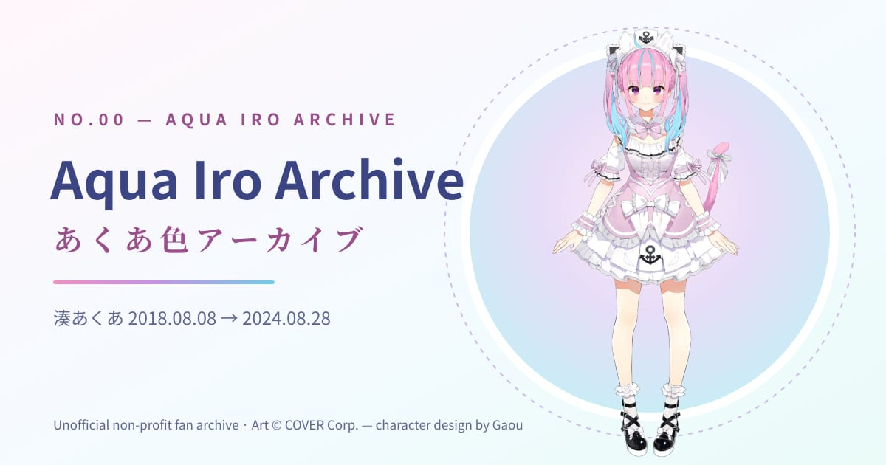
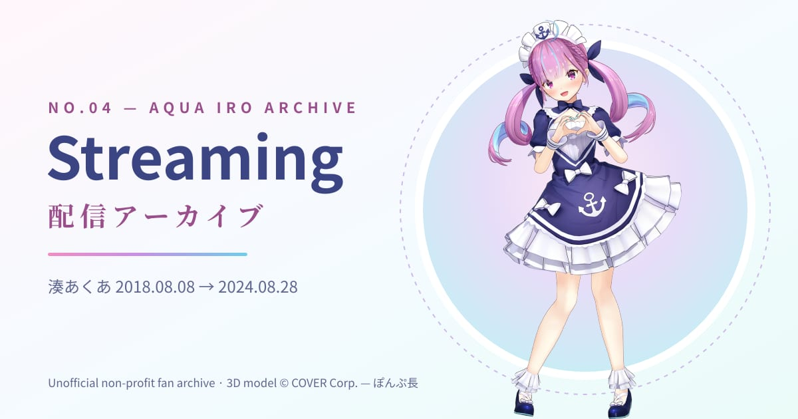
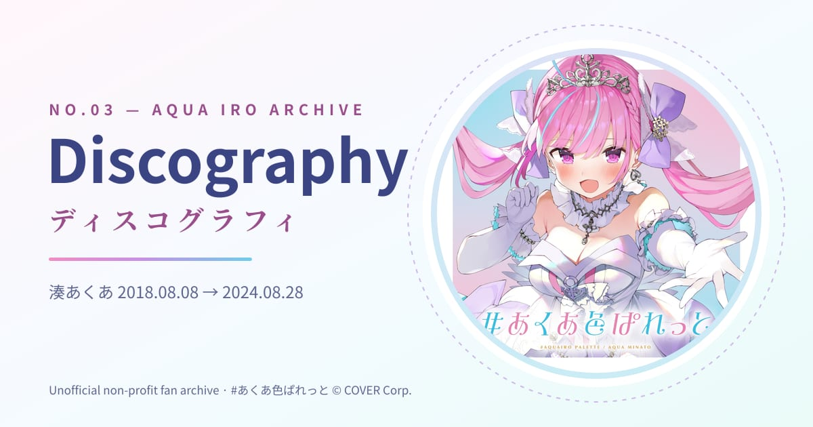
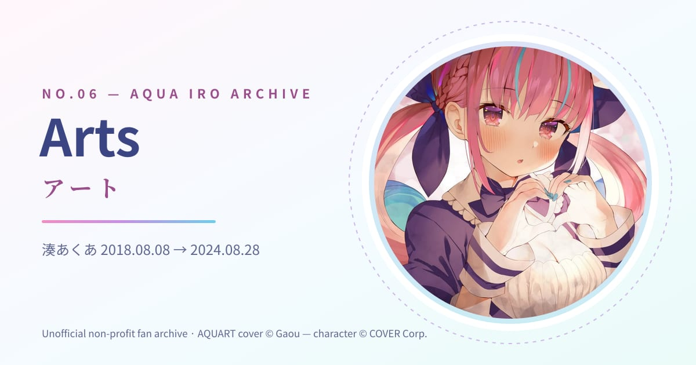
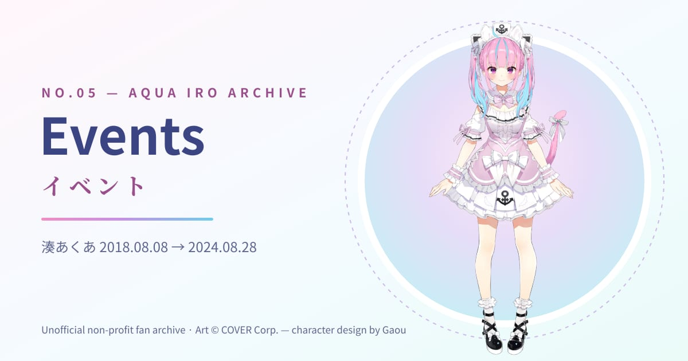
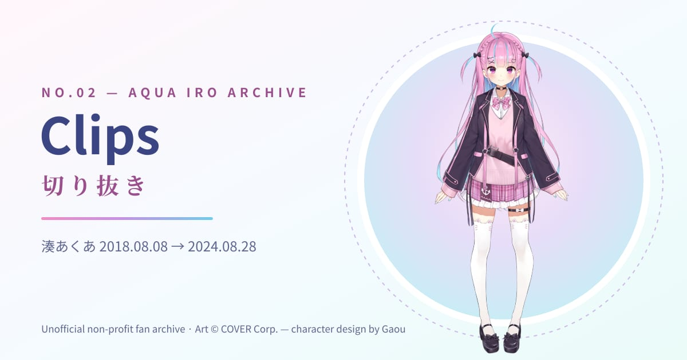
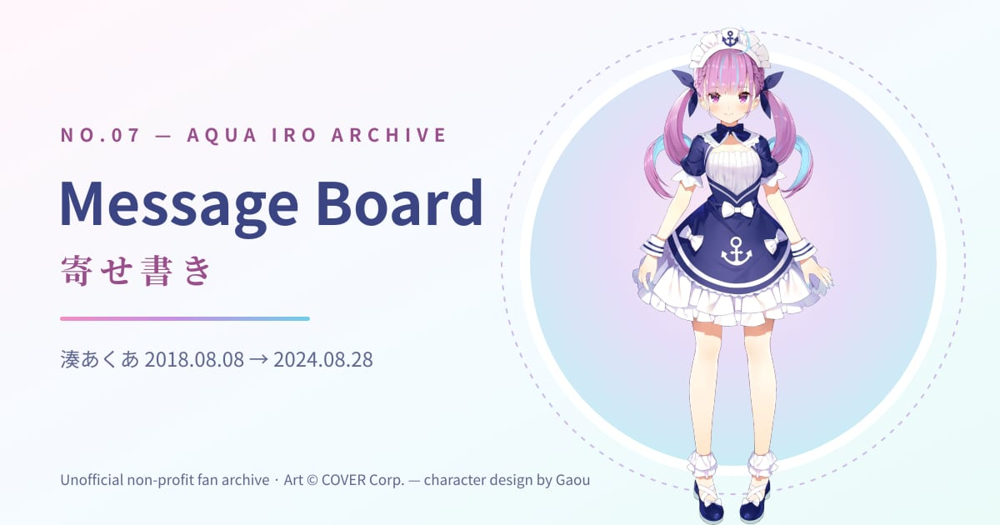
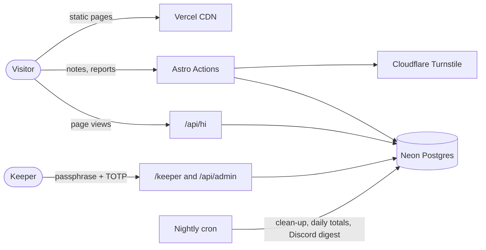

<div align="center">

<a href="https://aqua-iro-archive.vercel.app">
  
</a>

# Aqua Iro Archive · あくあ色アーカイブ

**An unofficial, non-profit fan archive of Minato Aqua (2018–2024)**<br>
湊あくあの6年間を残す、非公式・非営利のファンアーカイブ

<sub>Project 44.5 by <a href="https://moekoworks.vercel.app">Moeko Works</a></sub>

<br>

[](https://aqua-iro-archive.vercel.app)
[](https://aqua-iro-archive.vercel.app)

[](https://github.com/PastelSalt/aqua-iro-archive/actions/workflows/ci.yml)
[](https://astro.build)
[](https://preactjs.com)
[](https://neon.tech)
[-3e4a89>)](LICENSE)
[](#features)

[**Visit the archive**](https://aqua-iro-archive.vercel.app) ·
[Features](#features) ·
[Tech stack](#tech-stack) ·
[Run it locally](#run-it-locally) ·
[Corrections & removals](#corrections-and-removals)

</div>

---

## About

Minato Aqua (湊あくあ) was a hololive VTuber from **8 August 2018 to 28 August 2024**. This archive keeps those six
years in one calm, bilingual place: her streams, songs, clips, events and the fan art people made along the way, plus a
message board where anyone can leave her a note.

It's a fan project: made by fans, for fans, with no ads, no tracking cookies and no money involved. Everything is
credited, and anything can be taken down on request.

<table>
  <tr>
    <td><a href="https://aqua-iro-archive.vercel.app/streaming"></a></td>
    <td><a href="https://aqua-iro-archive.vercel.app/discography"></a></td>
    <td><a href="https://aqua-iro-archive.vercel.app/arts"></a></td>
  </tr>
  <tr>
    <td><a href="https://aqua-iro-archive.vercel.app/events"></a></td>
    <td><a href="https://aqua-iro-archive.vercel.app/clips"></a></td>
    <td><a href="https://aqua-iro-archive.vercel.app/messages"></a></td>
  </tr>
</table>

## Features

### Eight chapters

| Chapter                                                            | What's inside                                                                                |
| ------------------------------------------------------------------ | -------------------------------------------------------------------------------------------- |
| [**Home**](https://aqua-iro-archive.vercel.app)                    | The front page, with _Talk with Aqua_: 21 short conversations with choices, in her own words |
| [**About**](https://aqua-iro-archive.vercel.app/about)             | Profile, lore and outfits                                                                    |
| [**Clips**](https://aqua-iro-archive.vercel.app/clips)             | 30 fan-favourite clips, sortable by views or date                                            |
| [**Discography**](https://aqua-iro-archive.vercel.app/discography) | Originals, solo and collab covers, unit songs and releases (103 tracks)                      |
| [**Streaming**](https://aqua-iro-archive.vercel.app/streaming)     | 639 public stream archives: search, filter by year, sort by date, views or length            |
| [**Events**](https://aqua-iro-archive.vercel.app/events)           | A scroll-driven timeline of 60 milestones, plus brand collaborations                         |
| [**Arts**](https://aqua-iro-archive.vercel.app/arts)               | 190 curated official and fan artworks, each credited, with bilingual alt text                |
| [**Messages**](https://aqua-iro-archive.vercel.app/messages)       | The crew board: leave a note, become _Aqua Crew #N_                                          |

### Little things that make it feel like home

- **Fully bilingual.** Every page in Japanese and English, switchable at any time, with BudouX line breaking for Japanese.
- **A dock instead of a navbar**, with keyboard shortcuts, a first-visit tour, and a LOG drawer holding the
  conversation backlog, your memory album and the credits.
- **Aqua Time**: a VHS-style tape deck. Scrub to any day from her debut to her graduation and the whole archive shows
  that day, or jump to "On this day".
- **BGM capsule** and a **Motion** switch for people who prefer less animation.
- **Fast and light**: static pages, small Preact islands, per-page JavaScript budgets checked in CI.
- **Accessible**: keyboard-first, axe-checked in end-to-end tests, WCAG AA colour contrast checked by script.

### A message board that stays kind

No accounts and no names: every note gets a crew number. Posts pass Cloudflare Turnstile, server-side text checks (no
links, no personal info, a word filter), rate limits and raid detection. Visitors can report notes, and three reports
hide a note until the keeper reviews it.

### The Keeper

A private admin area (`/keeper`) for one keeper with mandatory two-factor sign-in: a moderation queue, word filters,
board settings, an audit log, error reports, and visitor statistics with archive insights (what people play, open and
search).

### Privacy first

The site counts its own visits: no third-party analytics, no cookies for visitors, IP addresses never stored, and a
visitor hash that changes every day. See the [privacy page](https://aqua-iro-archive.vercel.app/privacy).

## Tech stack

| Layer      | Choice                                                                                                                   |
| ---------- | ------------------------------------------------------------------------------------------------------------------------ |
| Framework  | [Astro 7](https://astro.build), static first, with [Preact](https://preactjs.com) islands and signals                    |
| Styling    | Plain CSS with design tokens; GSAP ScrollTrigger for the Events timeline                                                 |
| Content    | YAML and JSON content collections, validated at build time                                                               |
| Database   | [Neon](https://neon.tech) Postgres with [Drizzle ORM](https://orm.drizzle.team)                                          |
| Auth       | [Better Auth](https://www.better-auth.com) with TOTP two-factor (Keeper only)                                            |
| Bot checks | [Cloudflare Turnstile](https://www.cloudflare.com/products/turnstile/)                                                   |
| Analytics  | First-party and cookieless (`/api/hi`), see [docs/plans/ANALYTICS-REBUILD-PLAN.md](docs/plans/ANALYTICS-REBUILD-PLAN.md) |
| Hosting    | [Vercel](https://vercel.com) (region `sin1`), with a nightly clean-up cron                                               |
| Quality    | Vitest (board and analytics on in-process PGlite), Playwright + axe, visual snapshots, ESLint, Prettier                  |



## Run it locally

**Requirements:** Node 24 (see `.nvmrc`) and npm. A database is only needed for the message board and the Keeper.

```bash
git clone https://github.com/PastelSalt/aqua-iro-archive.git
cd aqua-iro-archive
npm ci
cp .env.example .env   # Cloudflare's testing keys are already in it
npm run dev            # http://localhost:4321
```

To look around the Keeper without a database or an account, run the preview. It uses a local in-process Postgres with
sample data and a stand-in admin, and never touches production:

```bash
npm run keeper:preview  # http://localhost:4322/keeper
```

For the real setup (Neon, secrets, the keeper account, Turnstile), see [docs/BOARD-SETUP.md](docs/BOARD-SETUP.md) and
[docs/RUNBOOK.md](docs/RUNBOOK.md).

<details>
<summary><b>All commands</b></summary>

| Command                                          | What it does                                                                                  |
| ------------------------------------------------ | --------------------------------------------------------------------------------------------- |
| `npm run dev`                                    | Dev server on :4321                                                                           |
| `npm run keeper:preview`                         | Keeper preview on :4322 (local sample database, stand-in admin)                               |
| `npm run build`                                  | `data` → `astro check` → `astro build` → prune unused images → CSP hashes into `vercel.json`  |
| `npm run data`                                   | Rebuild `streams.json` from `data/raw/` (+ `data/overrides/`) and validate the Talk scripts   |
| `npm test`                                       | Unit, data and integration tests (board and analytics run on PGlite with the real migrations) |
| `npm run test:e2e`                               | Playwright + axe against the built site, served with the `vercel.json` headers (CSP included) |
| `npm run test:visual`                            | Visual snapshots at laptop and phone sizes                                                    |
| `npm run lint` / `npm run format`                | ESLint + Prettier                                                                             |
| `npm run budget`                                 | Per-page JavaScript budget check                                                              |
| `npm run contrast`                               | WCAG AA check of the colour tokens                                                            |
| `npm run db:generate` / `db:migrate` / `db:seed` | Drizzle migrations (`db/migrations`) and seeds (`db/seed`)                                    |
| `npm run admin:create`                           | Create the keeper account (asks for the passphrase; sign-up is disabled in the app)           |
| `npx tsx scripts/reset-2fa.ts <email>`           | Reset the keeper's two-factor (see the runbook)                                               |
| `npx tsx scripts/make-og.ts`                     | Regenerate the 1200×630 share images in `public/og/`                                          |
| `node scripts/dev/perf.mjs`                      | Per-page load and scroll rendering cost (serve the build on :4321 first)                      |
| `node scripts/dev/visual-diff.mjs`               | Pixel-diff every page against the live site, to prove a change is invisible                   |

</details>

## Project structure

```text
src/
├── content/      # the archive itself: profile, clips, songs, events, arts, Talk scripts (YAML)
├── pages/        # the 8 chapters, credits, privacy, /keeper and /api
├── components/   # chrome (dock, LOG, BGM, Aqua Time, tour), board, talk, keeper, UI
├── server/       # board pipeline, moderation, security, analytics, auth, database
├── scripts/      # small browser behaviours (reveal, odometer, top bar, Keeper pages)
├── styles/       # design tokens and page styles
└── assets/       # curated images (processed at build time)
data/             # raw stream list and manual overrides
db/               # Drizzle migrations and seeds
docs/             # runbook, board setup, and plans/ (how each part was designed)
scripts/          # build, data, image and maintenance scripts; dev/ helpers
tests/            # unit, data, integration (PGlite) and end-to-end (Playwright) tests
```

Content lives in `src/content/**/*.yaml`. Streams are generated from `data/raw/` and `data/overrides/`, and the Talk
scripts have their own guide in [src/content/talk/README.md](src/content/talk/README.md).

## Corrections and removals

Spotted a mistake, a missing credit, or something you'd like taken down? Removal requests are honoured, no questions
asked.

- **Artists and rights holders:** use the [Moeko Works contact form](https://moekoworks.vercel.app/contact).
- **Fixes and suggestions:** [open an issue](https://github.com/PastelSalt/aqua-iro-archive/issues).
- **Security problems:** please report privately, see [SECURITY.md](SECURITY.md).

## Credits

- **Minato Aqua** (湊あくあ), with love and thanks for six years. 🫧⚓
- Character design by **Gaou** (がおう). Official art © **COVER Corp.** / hololive production.
- Fan art © each artist, credited on the [Credits page](https://aqua-iro-archive.vercel.app/credits).
- Icons: [Phosphor](https://phosphoricons.com) (MIT). Fonts: Fredoka, Zen Maru Gothic, Shippori Mincho (OFL, self-hosted).
- Made by [Moeko Works](https://moekoworks.vercel.app).

## License

The **source code** is released under the [MIT License](LICENSE).

The **content is not**: Minato Aqua's name, likeness and art, the fan art, and stream, clip and song titles,
thumbnails, video and audio belong to their respective owners and are used here non-commercially as a fan tribute.
If you reuse the code, replace the content with your own.

<div align="center">
<br>
<sub>This is an unofficial fan project. It is not affiliated with or endorsed by COVER Corp., hololive production or
Minato Aqua.</sub>
<br><br>
<sub>おつあくあ〜 ⚓</sub>
</div>
