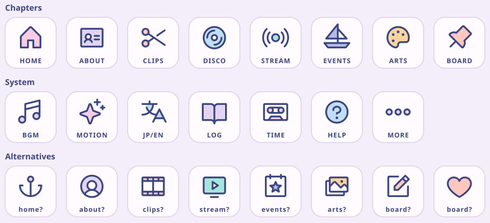

# Dock redesign plan (v2, simplified)

Updated 14 Oct 2026. The dock has been revised three times (`e9c5a0c`, `7aeefcc`, `be23987`) and is still
inconsistent in look and behaviour. This version follows your direction:

> make the logic and visual consistent, as simple as possible, before any more features. Only the
> extended dock, with icons; no small scrolled-state dock. Use an icon library.

Status: **built** (14 Oct 2026), with the default answers to §10 (the Chapters icon row, AUTO → MOTION).
Differences from the plan as written:

- **Icon colours are dock-only tokens** (`--icon-*` in `tokens.css`): each page's own tint is unchanged,
  so the Arts page keeps its colour. Messages uses a leaf green instead of the coral in the preview,
  which was too close to Clips.
- **The MORE sheet lives in `Dock.tsx`** (no separate `DockSheet.tsx`); it's small.
- **Toggles fade their colour** instead of cross-fading the icon.
- **While the MORE sheet is open, the dock's layer is raised above toasts**, so the Aqua Time
  "on this day" toast can't cover it.

---

## 1. What's wrong today (why simplify)

Checked on `/streaming` at 1920×953, 1366×649, 1024×700 and 390×664, in Japanese and English, at the
top and scrolled, plus the ⚙ popover, and by reading `Dock.tsx` (484 lines) and the dock CSS spread over
four stylesheets.

| #   | Problem                                                                                                                                                                                | Root cause                                           |
| --- | -------------------------------------------------------------------------------------------------------------------------------------------------------------------------------------- | ---------------------------------------------------- |
| 1   | **The ⚙ button can't be clicked with a mouse on desktop.** Hovering the small dock expands it, the expanded dock hides ⚙, so the click lands elsewhere. Failed at 1920, 1366 and 1024. | Two dock states, with hover switching between them   |
| 2   | **Things move under the cursor.** The dock grows from ~365 px to ~1000 px on hover, so the dot you aimed at jumps sideways.                                                            | Two dock states                                      |
| 3   | **16 different layouts.** 2 states × 4 width breakpoints × 2 languages, several never designed (e.g. the full dock overflows at 1024).                                                 | States + breakpoints decide visibility independently |
| 4   | **Resizing animates three ways at once** (JS width animation, CSS padding/radius transitions, labels popping), on different curves.                                                    | Two dock states                                      |
| 5   | **Chapters are told apart only by a 7 px coloured dot**, and two tints are nearly the same (Disco #8ec9ee, Arts #7fd9f2).                                                              | No icons                                             |
| 6   | **The dock is a different height in Japanese and English** (two-line vs one-line labels).                                                                                              | Bilingual second line                                |
| 7   | **The "NO.04 · STREAM" tab repeats the active chip** and keeps typing after the page has changed.                                                                                      | Extra element with its own timing                    |
| 8   | **Chapter buttons and system buttons look like two different components** (wide pills vs 48 px squares, different active styles). AUTO uses the anchor icon, which reads as "home".    | Built separately                                     |
| 9   | **Four accents compete** on one small bar: the typing tab, a progress line, a pulse ring and a bubble trail.                                                                           | Features added one at a time                         |

Problems 1–4 all come from having two dock states. Removing the second state removes all four.

---

## 2. The rules (the whole design in six lines)

1. **One dock, one size.** It never shrinks, grows or changes layout while you use the page: no scroll state, no hover state.
2. **One button component** for everything in the dock: icon on top, one short label underneath, the same size and the same states.
3. **The label is in the visitor's language** (JA: ホーム, EN: HOME): one line, so the dock is the same height in both languages.
4. **Two layouts only:** wide (≥ 1024 px) and narrow (< 1024 px). Nothing else changes with width.
5. **One active style** (the current chapter) and **one "on" style** (toggles like BGM). Nothing else changes colour.
6. **One motion for chapter changes** (the highlight slides), plus the same tiny hover and press feedback on every button.

---

## 3. Icons: Phosphor Icons (library)

**Library:** [Phosphor Icons](https://phosphoricons.com), `@phosphor-icons/core` 2.1.1, **MIT licence**.

- **Why Phosphor:** about 1,500 icons drawn as one consistent family. It has a **duotone** style (outline plus a soft 20% fill) that matches the site's pastel, sticker-like look better than plain line icons.
- **How it's used:** the SVG files are copied into the site's existing sprite **at build time**. No icon font, no JS library in the browser, nothing extra downloaded. Each icon is about 0.5–1 KB inline.
- **Colour:** the outline uses the text colour (navy). The duotone fill uses the chapter's tint, so the colour coding is kept, but as a supporting signal rather than the only one.

Preview of the proposed set (duotone, chapter tints as the fill):



### 3.1 Chapters

| Chapter                  | Icon (Phosphor name)  | Why                             |
| ------------------------ | --------------------- | ------------------------------- |
| No.00 Home ホーム        | `house`               | Universally "home"              |
| No.01 About プロフィール | `identification-card` | Profile card                    |
| No.02 Clips 切り抜き     | `scissors`            | 切り抜き = "cut-out"            |
| No.03 Discography        | `vinyl-record`        | Matches the page's record motif |
| No.04 Streaming 配信     | `broadcast`           | 配信 = broadcast                |
| No.05 Events             | `sailboat`            | The voyage timeline             |
| No.06 Arts               | `palette`             | The gallery                     |
| No.07 Messages 寄せ書き  | `push-pin`            | Notes pinned to a board         |

The Alternatives row of the sheet shows other options per chapter (`anchor-simple`, `user-circle`, `film-strip`, `monitor-play`, `calendar-star`, `images`, `note-pencil`, `heart`), if you prefer any of them.

### 3.2 System buttons

| Button             | Icon                 | Label      | Change from today                                                                      |
| ------------------ | -------------------- | ---------- | -------------------------------------------------------------------------------------- |
| BGM                | `music-notes`        | BGM        | redrawn                                                                                |
| Motion             | `sparkle`            | **MOTION** | was "AUTO" with the anchor icon, which read as "home"; the new label says what it does |
| Language           | `translate`          | JP/EN      | was the 文A text glyph                                                                 |
| Log                | `book-open`          | LOG        | was ☰, which reads as "menu"                                                          |
| Aqua Time          | `cassette-tape`      | TIME       | redrawn                                                                                |
| Help               | `question`           | HELP       | redrawn                                                                                |
| More (narrow only) | `dots-three-outline` | MORE       | replaces both ⚙ and the old MORE button                                                |

### 3.3 Tints

Each chapter keeps its colour as the icon's fill. Arts moves from #7fd9f2 to a warm yellow (#f6b84e, as in the preview) so it no longer looks like Discography. Clips, Streaming, Events and Messages are adjusted slightly so all eight are clearly different.

---

## 4. The dock

### 4.1 Wide layout (≥ 1024 px): desktop and laptop

```
 ╭──────────────────────────────────────────────────────────────────────────────────────────╮
 │ [🏠]  🪪   ✂   💿   📡   ⛵   🎨   📌       🎵    ✨    文A    📖    📼    ?                │
 │ HOME ABOUT CLIPS DISCO STREAM EVENTS ARTS BOARD   BGM  MOTION JP/EN  LOG  TIME  HELP        │
 ╰──────────────────────────────────────────────────────────────────────────────────────────╯
   ▲ current chapter: navy pill, white icon and label
```

- **14 buttons in one bar:** 8 chapters, a 16 px gap, then 6 system buttons.
- **Each button:** 64 × 56 px, radius 16. The icon is 24 px, with the label underneath at 10 px uppercase in English or 11 px in Japanese, using the `--label-s` token.
- **Total width:** about 14 × 64 + gaps ≈ 940 px, which fits 1024 px with margins and leaves room at 1366 and 1920.
- **Placement:** fixed at the bottom centre, same position on every page, always the same size.
- **Removed:** the "NO.04 · STREAM" tab (the page itself starts with its No.0X label), the progress line, the pulse ring, the bubble trail, and the separator line (replaced by the gap).

### 4.2 Narrow layout (< 1024 px): tablets and phones

My decision for mobile, chosen to be the simplest consistent version of the wide dock:

```
 ╭──────────────────────────────────────────────────╮
 │ [🏠]   ✂    💿    📡    📌    ⋯                  │
 │ HOME CLIPS DISCO STREAM BOARD MORE               │
 ╰──────────────────────────────────────────────────╯
```

- **The same button component**, just fewer of them: Home, Clips, Disco, Stream, Board, and **MORE**. If you're on a chapter not in the bar (About, Events, Arts), it replaces Clips so the current chapter is always visible (as today).
- **MORE opens one bottom sheet with everything:** all 8 chapters (same icons, as a 4×2 grid, in the visitor's language) and the 6 system buttons below them.
  - This replaces today's two separate menus (the MORE chapter sheet and the ⚙ popover).
  - The sheet closes with ×, a tap outside, Esc, or after you pick something.
- **Size:** full width minus 8 px margins, 60 px tall; buttons share the width equally.
- **Same rules:** no shrinking while scrolling, one active style.

### 4.3 States (complete list)

| Situation                                               | Dock                                              |
| ------------------------------------------------------- | ------------------------------------------------- |
| Normal (any page, any scroll position)                  | Shown, full size                                  |
| A drawer, lightbox, tape deck or the MORE sheet is open | Slides down out of view (as today)                |
| Keyboard focus                                          | Shown (it always is), with focus rings on buttons |

That's all. **Removed:** compact, peek, hover expansion, idle timers, scroll thresholds, the per-page tour hold, and the 900 ms "quiet" windows. The tour no longer needs to hold the dock open, because it is always open.

### 4.4 Styles (complete list)

| Style                    | Look                                                                             | Used for                                               |
| ------------------------ | -------------------------------------------------------------------------------- | ------------------------------------------------------ |
| Rest                     | transparent background, navy icon (tinted fill for chapters), soft-ink label     | every button                                           |
| Hover                    | pink wash background, icon up 2 px                                               | every button (mouse only)                              |
| Focus                    | the site's focus ring                                                            | every button (keyboard)                                |
| Active (current chapter) | navy pill, white outline, label and icon outline, the icon keeps its tinted fill | chapters only                                          |
| On (toggle)              | pink wash background, pink-ink icon and label                                    | BGM while playing, Motion when on, TIME when travelled |

---

## 5. Motion (complete list)

| Event               | Animation                                                                                 | Duration                                 |
| ------------------- | ----------------------------------------------------------------------------------------- | ---------------------------------------- |
| Hover               | background fade-in, icon moves up 2 px                                                    | 160 ms                                   |
| Press               | button scales to 0.94 and back                                                            | 100 ms                                   |
| Chapter change      | the navy pill **slides** from the old chapter to the new one, timed with the page shutter | 320 ms, `cubic-bezier(0.22, 1, 0.36, 1)` |
| Toggle on/off       | icon cross-fades                                                                          | 180 ms                                   |
| MORE sheet (narrow) | slides up from the bottom                                                                 | 280 ms                                   |

All animations use `transform` and `opacity` only. With Motion OFF they are all instant. The pill slide is the only chapter-change effect in the dock; the shutter stays as the page's own transition.

---

## 6. Code

| File                               | Contents                                                                                                                                                                                                                                                    |
| ---------------------------------- | ----------------------------------------------------------------------------------------------------------------------------------------------------------------------------------------------------------------------------------------------------------- |
| `scripts/build-icons.ts`           | Copies the chosen Phosphor duotone SVGs into the sprite as `<symbol id="ph-…">` at build time                                                                                                                                                               |
| `lib/chapters.ts`                  | Adds `icon` (Phosphor name) and `short` (narrow label) per chapter: the one source for icons and labels                                                                                                                                                     |
| `components/chrome/Dock.tsx`       | Rewritten small: renders the buttons from data; wide/narrow is decided by CSS only (both sets are in the markup); slides the active pill. No scroll listeners, no state machine. Keyboard shortcuts (1–8, Esc, Alt+M/L) and analytics carry over unchanged. |
| `components/chrome/DockButton.tsx` | The single button component (icon + label + the four styles)                                                                                                                                                                                                |
| `components/chrome/DockSheet.tsx`  | The narrow-layout MORE sheet                                                                                                                                                                                                                                |
| `styles/dock.css`                  | All dock CSS in one file; the old dock rules are removed from `components.css`, `motion.css`, `fill.css` and `aquatime.css`                                                                                                                                 |

Expected size: `Dock.tsx` goes from 484 lines to roughly 150, plus about 60 for the button and 80 for the sheet.

Other places that change as a result:

| Place                | Change                                                                                                                       |
| -------------------- | ---------------------------------------------------------------------------------------------------------------------------- |
| Tour                 | The steps that pointed at ⚙ or waited for the dock to expand point at the buttons directly; the "dock hold" event is removed |
| HELP                 | Text updated (MOTION instead of AUTO, the new icons)                                                                         |
| Chrome scroll script | The dock progress line goes, so it only handles the logo swing                                                               |
| Layout tests         | The audit-era tests for compact/expanded are replaced by the checks in §7                                                    |

---

## 7. Acceptance checks (automated, `tests/e2e/dock.spec.ts`)

1. **Clickable everywhere:** every dock button, and every item in the MORE sheet, can be clicked at 1920, 1366, 1024, 768 and 390 px.
2. **The dock never changes size:** its width and height are identical at the top of a page, after scrolling down, after scrolling up, and while hovering.
3. **Same height in Japanese and English.**
4. **One active style:** the current chapter's button has the same computed style on every page.
5. **Real icons:** every button shows the expected Phosphor icon (checked by its `<use href>`).
6. **Narrow layout:** the current chapter is always in the bar; MORE lists all 8 chapters and the 6 system buttons.
7. **Motion OFF:** no dock animation runs.
8. **By eye:** screenshots of both layouts × both languages × top/scrolled, reviewed before shipping.

---

## 8. Steps

1. Add `@phosphor-icons/core`, the build-time icon copy, and the icon/short fields in `chapters.ts`.
2. The `DockButton` component and `dock.css` for both layouts.
3. Rewrite `Dock.tsx` (no states) and add `DockSheet` for narrow screens.
4. Remove the old dock code: compact styles, plate, progress line, pulse, bubble trail, hover/scroll logic, dock hold.
5. Update the Tour and HELP text.
6. `dock.spec.ts`, run the full test suite, screenshot review at all sizes and both languages, ship.

## 9. Already decided (from your message)

- **Only the extended dock**, with icons: no small scrolled state.
- **Icons from a library:** Phosphor (duotone, MIT).
- **Mobile:** the narrow layout in §4.2 (5 chapters + MORE, one sheet for everything).

## 10. Open questions (I'll use the first option unless you say otherwise)

1. **Icons:** the Chapters row in the preview (`house`, `identification-card`, `scissors`, `vinyl-record`, `broadcast`, `sailboat`, `palette`, `push-pin`), or swap any for an Alternative?
2. **AUTO → MOTION:** rename the label (recommended), or keep "AUTO"?
